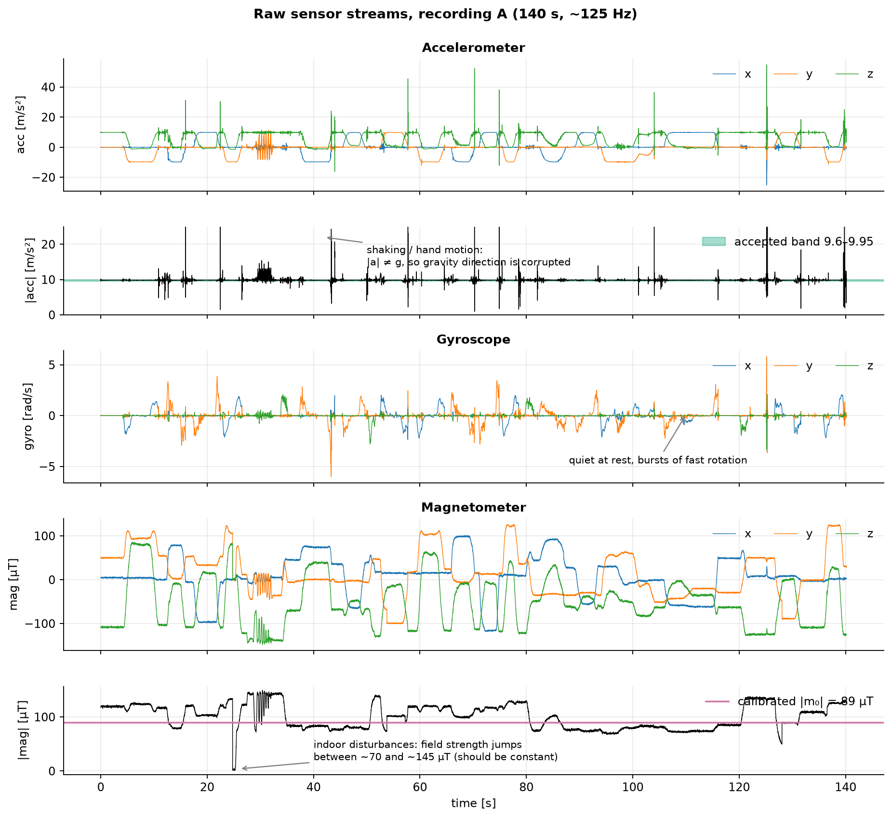
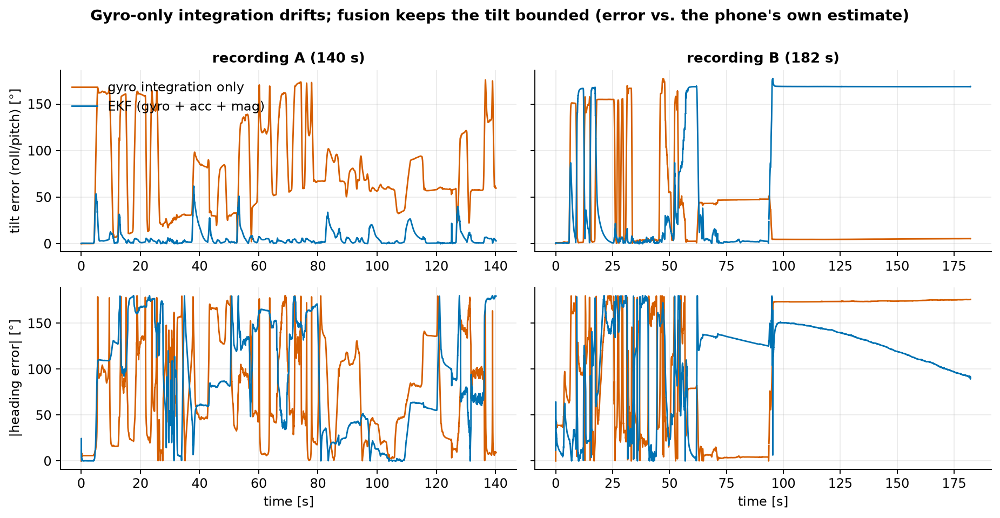
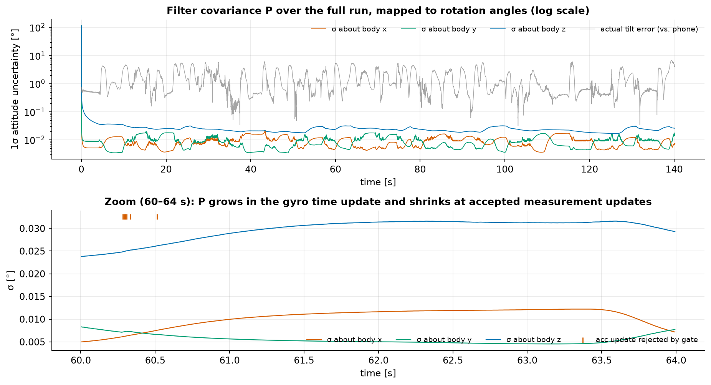
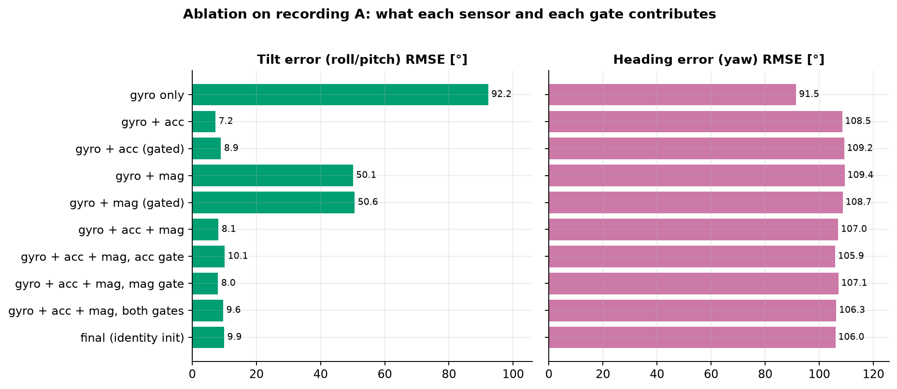

# Phone orientation EKF

**A quaternion Extended Kalman Filter that fuses a smartphone's gyroscope, accelerometer and magnetometer into a 3D orientation, with outlier rejection, validated against recorded live data.**


<sub>Recording A, 86–107 s. Left: the phone's own estimate (reference). Middle: this EKF. Right: gyro integration only, started aligned at t = 0 and never corrected. The 20 s window was selected automatically as the span with the lowest EKF heading error that still contains motion, so it is a best-case window. Heading errors elsewhere in the run are large; see [Results](#results). Bottom: error curves for the whole window.</sub>

-orange)  

> **Coursework project** (SSY345 Sensor Fusion and Nonlinear Filtering, Chalmers), done in a group of two. The course supplied the
> task, the live-streaming template, the visualisation class, the Java data receiver, the Sensor Fusion phone app and the basic quaternion helper
> functions. The filter equations, outlier gates, calibration, recordings, tuning and analysis are the group's own work; this repo is my re-engineered, re-analysed version of it. See [Acknowledgements](#acknowledgements).

## TL;DR

* **Problem:** estimate a phone's 3D orientation in real time from three cheap, individually unreliable sensors.
* **Approach:** EKF with a unit quaternion as state. The gyroscope drives the time update, the accelerometer (gravity) and magnetometer (magnetic north) drive the measurement updates, and two gates reject accelerometer samples that are not gravity-only and magnetometer samples that jump.
* **Results** (recording A, vs. the phone's own estimate, which is a *reference, not ground truth*):
  * **Tilt (roll/pitch): 2.1° RMSE, 6.9° max**, against 48.5° RMSE for gyro integration alone.
  * **Heading (yaw): 10° median error, within 20° for 72% of the time, but 55° RMSE** because of indoor magnetic disturbances that corrupt both my filter and the reference.
* **Verification:** the Python port reproduces the quaternion output of the original MATLAB live runs on all 6 recordings (max difference 6.5e-8).
* **A bug found:** the template's gyro process model is inconsistent with its measurement model. Fixing it cut tilt RMSE on recording A from 9.9° to 2.1° ([findings](docs/findings.md)).

## Why it's hard

| Challenge | What happens |
|---|---|
| **Gyro drift** | Integrating angular rate accumulates error. Gyro-only tilt error reaches 48° after 60 s on recording A. |
| **Accelerometer ≠ gravity** | It measures gravity *plus* hand acceleration. Tilt from it is only valid when the phone is not accelerating. |
| **Magnetic disturbance** | Indoors, the measured field strength jumps between ~70 and ~145 µT (the true field is constant, ~89 µT calibrated). Heading from it is unreliable. |
| **Non-linear rotations** | Orientation is not a vector: measurements are non-linear in the quaternion, so the filter needs Jacobians and renormalisation. |
| **Heading is only observable through the magnetometer** | Gravity says nothing about rotation about the vertical. |


*Raw streams of recording A. Note the gravity-sized |a| ≈ 9.8 at rest with spikes during motion, and the steps in the magnetometer norm.*

## Approach


State: unit quaternion $q$ (world→sensor), covariance $P$. Full derivation: [docs/derivation.md](docs/derivation.md); conventions: [docs/conventions.md](docs/conventions.md).

**Time update (gyroscope $\omega$, sample time $T$):**
$$q\leftarrow\big(I+\tfrac T2 S(\omega)\big)q,\qquad P\leftarrow FPF^\top+G R_\omega G^\top$$

**Measurement update** for $y=Q(q)v_0+e$, with $v_0=g_0$ (accelerometer, gravity) or $m_0$ (magnetometer, field), linearised through $H=\big[\tfrac{\partial Q}{\partial q_i}v_0\big]_{i=0..3}$:
$$K=PH^\top(HPH^\top+R)^{-1},\quad q\leftarrow q+K\,(y-Q(q)v_0),\quad P\leftarrow P-KSK^\top$$

**Normalisation:** $q\leftarrow q/\|q\|$, sign fixed so $q_0\ge0$, after every update. (This is plain renormalisation; $P$ is left unchanged.)

**Outlier rejection:**
* accelerometer update only if $9.6<\|a\|<9.95\ \text{m/s}^2$ (gravity ≈ 9.84 at rest);
* magnetometer update only if $\|m_k-\hat L_k\|<\tau$ with running mean $\hat L_k=(1-\alpha)\hat L_{k-1}+\alpha m_k$.

**Parameters used in the live runs:** acc gate 9.6–9.95 m/s², $\alpha=0.6$, $\tau=0.9$ µT, $\hat L_0$ = calibration mean. $R_a$, $R_\omega$, $R_m$ and $g_0$, $m_0$ come from the sample mean and covariance of a stationary calibration recording ([`data/calibration.json`](data/calibration.json); e.g. $\mathrm{diag}\,R_a=[5.2,3.9,86]\cdot10^{-5}$, $\mathrm{diag}\,R_m=[0.59,0.41,1.04]$; $g_0=[0.07,-0.05,9.84]$, $m_0=[0,\,55.8,\,-69.6]$ µT). The raw calibration recording is not in the repo.
The values α, τ and the gate limits were chosen by the group by trial and tuning; the tuning script's outcome was not recorded, I recovered the values by searching which settings reproduce the stored live output ([validation](docs/findings.md)).

## Results

Reference = the phone's own orientation output (also magnetometer-based, also disturbed indoors). Errors skip the first 5 s. Definitions of tilt/heading error: [conventions](docs/conventions.md#error-metrics). Full table: [`results/metrics.csv`](results/metrics.csv).

| Recording | Config | Tilt RMSE | Tilt max | Heading median \|err\| | Heading within 20° | Heading RMSE |
|---|---|---|---|---|---|---|
| A (140 s) | **final: EKF, both gates** | **2.1°** | **6.9°** | **10.5°** | **72%** | 54.7° |
| A | gyro only (started from reference) | 48.5° | 71.6° | 18.1° | 58% | 53.5° |
| A | as submitted (template process model) | 9.9° | 61.7° | 84.1° | 13% | 106.3° |
| B (182 s) | **final: EKF, both gates** | **1.7°** | **8.6°** | 40.8° | 23% | 64.2° |
| B | gyro only (started from reference) | 4.5° | 7.2° | 99.0° | 14% | 80.3° |
| B | as submitted (template process model) | 126.6° | 177.5° | 128.9° | 7% | 122.9° |

Gyro-only tilt error after 30 / 60 / 120 s: **A: 26° / 48° / 58°** (it grows in bursts during fast rotations), **B: 1.6° / 3.3° / 4.9°** (mostly at rest). B is mostly stationary after 95 s with a constant but strange magnetometer norm (~40 µT), so its heading numbers mostly reflect a slow convergence ([gyro_drift.png](results/figures/gyro_drift.png)). The metrics have no ground truth behind them: heading differences can be errors of my filter, of the reference, or both.


*Roll and pitch follow the reference closely through all motions. Yaw agrees outside the disturbed spans (≈13–16 s, 25–38 s, 52–58 s, 65–72 s, 127–137 s) where the magnetometer norm moves and the reference's own yaw wanders too.*


*Gyro-only integration (orange) drifts away; with accelerometer fusion (blue) tilt stays bounded. Heading is only as good as the magnetometer allows.*


*Filter uncertainty: $P$ mapped to rotation angles grows during gyro prediction and shrinks at accepted updates, but at 0.01–0.03° it is about 100× smaller than the real tilt error (grey). The filter is over-confident because only sensor noise is modelled.*


*Both gates over a magnetic disturbance (12–45 s). Accelerometer gate: red samples are during hand motion. Magnetometer gate: it rejects sudden jumps (e.g. at 25 s where |m| drops to ~0) but, since $\hat L$ catches up within a few samples, it accepts persistent disturbances.*

## Ablations & lessons learned



(Ablation filters start from the reference orientation so that initial misalignment does not mask the effect; the "final (identity init)" row is the deployed setting. Numbers: `results/metrics.csv`.)

* **Accelerometer is what bounds tilt:** gyro-only 48.5° → gyro+acc 2.3° RMSE.
* **Accelerometer gate:** tilt max 13.1° → 6.9° on A (24.5° → 8.4° on B), RMSE 2.3° → 2.05° (B: 2.55° → 1.62°).
* **Magnetometer supplies heading, nothing else:** gyro+acc+mag has 11° median heading error vs 70° for gyro+acc. Magnetometer alone (without acc) cannot fix tilt (37° RMSE): one vector measurement leaves a rotation about itself unobserved.
* **The magnetometer gate does not measurably help** here (heading RMSE 52.8° → 52.5° on A, 61.2° → 61.8° on B), because it only catches transients. An extra gate on the field *norm* (my addition, not in the course version) is worse: it rejects up to 80% of samples and heading degrades (median 10° → 21° on A).
* **Sensitivity** ([sensitivity.png](results/figures/sensitivity.png)): tilt is insensitive to α and τ (2.0–2.1° on A). Heading is flat for large τ but collapses on B for small τ with moderate α (up to 139° RMSE) when the gate rejects almost all magnetometer samples. The live values are in the safe region, not the best one.
* **Model consistency matters more than tuning:** a convention mismatch between the process and measurement models ([findings](docs/findings.md)) cost more accuracy than any gate or parameter, and it hid behind plausible-looking plots. A cheap check found it: predict 2 s ahead from the reference orientation using only the gyro.


## Real-time implementation

The original filter runs live: the Sensor Fusion phone app streams sensor data over TCP (port 3400) into MATLAB through the course's Java receiver, `runEkfLive` runs one filter iteration per received sample (data within 5 ms are treated as concurrent, ~125 Hz), and a 3D viewer (course-provided `OrientationView`) shows the EKF's phone box next to the phone's own estimate, flagging samples rejected by the gates. The recordings in `data/` came from this setup.

* Code: [`src/matlab/live/runEkfLive.m`](src/matlab/live/runEkfLive.m), sharing `ekfStep.m` with the offline runner.
* **Not runnable from this repo as is, and not tested here:** it needs the course's `sensordata.jar` (put it in `src/matlab/live/lib/`, then run `startup`) and `OrientationView.m`, neither of which is redistributed, plus the phone app, and I had no MATLAB licence or phone stream while preparing this repo.

## How to run

Python 3.10+; no MATLAB needed.

```bash
python -m venv .venv && source .venv/bin/activate
pip install -r requirements.txt
make demo         # ~5 s: runs the EKF on recording A, prints metrics
make test         # ~10 s: port == MATLAB output, Jacobian check, kinematics check
make figures      # ~5 min on 8 cores: every number, figure and the GIF in results/
```

Expected `make demo` output (tilt RMSE 2.05, tilt max 6.87, heading median 10.48, heading RMSE 54.72). With MATLAB: `run src/matlab/scripts/reproduceMetrics.m` (same numbers expected, **untested**).

## Repo map

```
README.md                   this file
data/                       6 recordings (.mat), calibration.json, data description
src/python/orientation_ekf/ quaternion.py (math), ekf.py (filter core), data.py, metrics.py
src/python/run_demo.py      quick demo
src/matlab/ekf/             ekfTimeUpdate, ekfMeasUpdate, ekfStep, ekfConfig, runEkfOffline
src/matlab/quaternion/      Qq, dQqdq, Somega, Sq, normalizeQuat, quatError, quatToEuler
src/matlab/live/            runEkfLive (smartphone stream + 3D viewer), startup
src/matlab/scripts/         reproduceMetrics
scripts/                    run_experiments.py, make_figures.py, make_animation.py, make_all.py
tests/test_filter.py        validation against the stored MATLAB output
results/                    metrics.csv, sensitivity.csv, validation.csv, figures/, animations/
docs/                       derivation.md, conventions.md, findings.md
```

## Skills demonstrated

| Skill | Evidence |
|---|---|
| Bayesian state estimation | EKF over a quaternion state with time/measurement updates: [`ekf.py`](src/python/orientation_ekf/ekf.py), [derivation](docs/derivation.md) |
| EKF derivation, linearisation, Jacobians | $H=[\partial Q/\partial q_i\,v_0]$, [`dQqdq`](src/python/orientation_ekf/quaternion.py), finite-difference check in [`tests/test_filter.py`](tests/test_filter.py) |
| Quaternion math & attitude representation | Conventions, kinematics, swing–twist error split: [conventions](docs/conventions.md), [`quaternion.py`](src/python/orientation_ekf/quaternion.py) |
| Sensor modelling & calibration | Noise covariances from stationary data: [`calibration.json`](data/calibration.json), [calibration_noise.png](results/figures/calibration_noise.png), consistency check in [findings §5](docs/findings.md) |
| Robust filtering / outlier rejection | Acc norm gate + adaptive magnetometer gate: [outlier_gates.png](results/figures/outlier_gates.png) |
| Filter tuning & ablation methodology | [ablation.png](results/figures/ablation.png), [sensitivity.png](results/figures/sensitivity.png), [`metrics.csv`](results/metrics.csv) |
| Debugging / verification | Port validated to 6.5e-8 against MATLAB output; found the process/measurement model inconsistency and a complex-valued `m0` bug ([findings](docs/findings.md)) |
| Real-time streaming & signal processing | Live loop with 5 ms sample grouping and gating: [`runEkfLive.m`](src/matlab/live/runEkfLive.m) (written for the course; not re-run here) |
| MATLAB and Python scientific computing | Both implementations of the same filter |
| Reproducible research & scientific visualisation | One-command pipeline `make figures`, colour-blind-safe figures, 3D animation |
| Technical writing | This README and [`docs/`](docs/) |

## Limitations & future work

* **Heading is the weak point.** There is no clean magnetometer reference indoors; the reference itself is magnetometer-based, so heading "error" mixes both estimators' errors. A mapping of the field norm or rejecting persistent disturbances (not only jumps) would be the next step.
* **Reference, not ground truth.** An external motion-capture or turntable reference would be needed for absolute accuracy claims.
* **Two recordings with a reference and all sensors; tuning is by hand.** Results depend on τ, α and the gate limits, and the stored calibration covariances are not stationary-condition invariant ([findings §5](docs/findings.md)).
* **Over-confident covariance:** no gyro-bias state, no model for linear acceleration, no covariance-consistent normalisation. Process noise reuses the sensor noise covariance.
* **MATLAB code untested here;** the verified implementation is the Python port (which matches the recorded MATLAB output).
* **Not done:** UKF/particle-filter comparison, complementary/Madgwick/Mahony baselines, adaptive noise, bias estimation in the state, error-state formulation.

## Acknowledgements

* SSY345 Sensor Fusion and Nonlinear Filtering, Chalmers University of Technology: task definition, live-streaming template, `OrientationView`, Java stream receiver, Sensor Fusion app, and the original quaternion helper functions (all rewritten here, not copied). None of the course-provided files are redistributed.
* Group project with a fellow student (GitHub `Anrid239`), who contributed plotting code and recordings per the original repo's commit history. The two group members' exact split of the analysis is not reconstructed here.
* Original repository: `AdyuthHisham/SSY345_Project_Final` (left untouched).

## License
MIT, see [LICENSE](LICENSE). Recorded data from the group's own phone.
