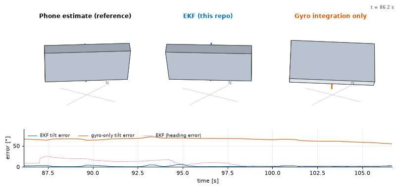
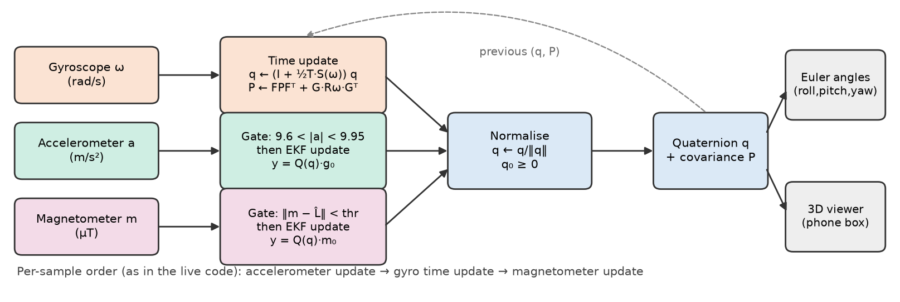
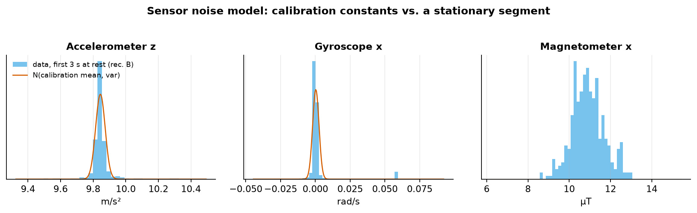

# Phone Orientation EKF

> **What is this project about?** A phone knows which way it is facing by combining three weak sensors. We built the filter that does this (a quaternion Extended Kalman Filter), made it robust to hand motion and magnetic disturbance, found and fixed a modelling bug in the course starting point, and checked it on recorded live data.

  

## TLDR (In brief)



<sub>Recording A, 86–107 s (best-case window, picked automatically as the 20 s with the lowest heading error that still contains motion). Left: the phone's own estimate (reference). Middle: **our EKF**. Right: gyro integration only, never corrected. Bottom: error curves.</sub>

* **Problem:** estimate a phone's 3D orientation in real time from a gyroscope (drifts), an accelerometer (corrupted by hand motion) and a magnetometer (corrupted indoors).
* **Approach:** EKF with a unit quaternion as state. Gyro drives the prediction; accelerometer (gravity) and magnetometer (north) drive the corrections; two gates reject bad samples.
* **Results** (recording A, vs. the phone's own estimate):

| | Our EKF | Gyro only |
|---|---|---|
| Tilt (roll/pitch) RMSE | **2.1°** | 48.5° |
| Tilt max | **6.9°** | 71.6° |
| Heading (yaw) median error | **10.5°** (within 20° for 72% of the time) | 18.1° |
| Heading RMSE | 54.7° (magnetic disturbances) | 53.5° |

## Repo Map

```
data/                       6 recordings (.mat), calibration.json, data description
src/python/orientation_ekf/ quaternion.py, ekf.py (filter core), data.py, metrics.py
src/python/run_demo.py      5-second demo
src/matlab/ekf/             ekfTimeUpdate, ekfMeasUpdate, ekfStep, ekfConfig, runEkfOffline
src/matlab/quaternion/      Qq, dQqdq, Somega, Sq, normalizeQuat, quatError, quatToEuler
src/matlab/live/            runEkfLive (smartphone stream + 3D viewer)
scripts/                    run_experiments.py, make_figures.py, make_animation.py, make_all.py
tests/test_filter.py        validation against the stored MATLAB output
results/                    metrics.csv, sensitivity.csv, figures/, animations/
docs/                       derivation.md, conventions.md, findings.md
```

## Problems we had to solve

| # | Problem | Why it matters |
|---|---|---|
| P1 | **Gyro drift** | Integrating angular rate accumulates error without bound. |
| P2 | **Accelerometer ≠ gravity** | It also feels hand acceleration, so the "down" direction is wrong while moving. |
| P3 | **Magnetic disturbance** | Indoors the field strength jumps between ~70 and ~145 µT, so heading is unreliable. |
| P4 | **Non-linear rotations** | Measurements are non-linear in the quaternion; it must stay unit length. |
| P5 | **Unknown sensor noise** | The filter needs covariances for all three sensors. |
| P6 | **Is the filter itself right?** | No ground truth exists; we only have the phone's own estimate to compare with. |


*Raw streams (recording A): |a| ≈ 9.8 m/s² at rest with spikes during motion (P2), and steps in the magnetometer norm (P3).*

## Approach we took



State: unit quaternion $q$ (world→sensor) and covariance $P$. Per sample: accelerometer update → gyro time update → magnetometer update. Full derivation in [docs/derivation.md](docs/derivation.md), conventions in [docs/conventions.md](docs/conventions.md).

**Time update** (gyro $\omega$, sample time $T$):
$$q\leftarrow\big(I+\tfrac T2 S(\omega)\big)q,\qquad P\leftarrow FPF^\top+G R_\omega G^\top$$

**Measurement update** for $y=Q(q)v_0+e$ with $v_0=g_0$ (accelerometer) or $m_0$ (magnetometer), linearised with $H=\big[\tfrac{\partial Q}{\partial q_i}v_0\big]_{i=0..3}$:
$$K=PH^\top(HPH^\top+R)^{-1},\quad q\leftarrow q+K\,(y-Q(q)v_0),\quad P\leftarrow P-KSK^\top$$

**Normalisation:** $q\leftarrow q/\|q\|$ with $q_0\ge0$ after every update.

**Outlier gates:**
* accelerometer update only if $9.6<\|a\|<9.95\ \text{m/s}^2$;
* magnetometer update only if $\|m_k-\hat L_k\|<\tau$, with running mean $\hat L_k=(1-\alpha)\hat L_{k-1}+\alpha m_k$ ($\alpha=0.6$, $\tau=0.9$ µT).

**Noise model:** $R_a$, $R_\omega$, $R_m$, $g_0$, $m_0$ are the mean and covariance of a stationary calibration recording ([`data/calibration.json`](data/calibration.json); e.g. $\mathrm{diag}\,R_a=[5.2,3.9,86]\cdot10^{-5}$, $\mathrm{diag}\,R_m=[0.59,0.41,1.04]$, $m_0=[0,\,55.8,\,-69.6]$ µT).

**Verification:** we ported the filter to Python and made it reproduce the quaternion output of our original MATLAB live runs on all 6 recordings (max difference 6.5e-8). The live run settings were recovered by searching for the settings that reproduce the stored output.

## Our solutions

### P1 Gyro drift, solved by fusion
Gyro-only tilt error grows to 48° after 60 s on recording A; with accelerometer fusion it stays below 7°.


Gyro-only tilt error after 30 / 60 / 120 s: **A 26° / 48° / 58°**, B 1.6° / 3.3° / 4.9° (B is mostly at rest).

### P2 Hand acceleration, solved by the accelerometer gate
Updates are skipped when $\|a\|$ leaves the gravity band (red samples below). The gate cuts the worst tilt error from 13.1° to 6.9° on A (24.5° to 8.4° on B).


### P3 Magnetic disturbance, partly solved by the adaptive magnetometer gate
The gate rejects sudden field jumps (e.g. at 25 s where $|m|$ drops to ~0). Because $\hat L$ catches up within a few samples, it accepts a disturbance that persists, so heading in strongly disturbed spans (≈13–16 s, 25–38 s, 52–58 s, 65–72 s, 127–137 s) is still wrong. Outside them the EKF follows the phone's yaw.


The sensitivity of the gate to $\alpha$ and $\tau$: tilt is insensitive (2.0–2.1° on A); heading is flat for large $\tau$ and collapses on B when a small $\tau$ rejects almost every magnetometer sample.


### P4 Non-linearity, solved with the EKF Jacobian and renormalisation
$H=[\partial Q/\partial q_i\,v_0]$ is implemented in `dQqdq` and checked against finite differences in `tests/test_filter.py`. The covariance mapped to rotation angles grows during gyro prediction and shrinks at accepted updates:


### P5 Sensor noise, solved with calibration statistics
Mean and covariance from a stationary recording give $R_a,R_\omega,R_m$.



### P6 Is the filter right? Solved by ablation, validation, and a bug hunt
**Ablation** (filters start from the reference so initial misalignment does not mask effects). The accelerometer bounds tilt (48.5° → 2.3°), its gate improves it further (2.05°), and the magnetometer is what gives heading (median error 70° with accelerometer only, 11° with magnetometer added).


**A modelling bug found and fixed.** The course-style gyro process model was inconsistent with the measurement model $y=Q(q)v$. A 2 s prediction test from the reference orientation showed tilt error with a 90th percentile of 167° for the original model and 6° for the corrected one. Fixing it:

| Recording | | Tilt RMSE | Tilt max |
|---|---|---|---|
| A | original model | 9.9° | 61.7° |
| A | **corrected (this repo)** | **2.1°** | **6.9°** |
| B | original model | 126.6° | 177.5° |
| B | **corrected (this repo)** | **1.7°** | **8.6°** |

Further findings (reference convention, a complex-valued `m0`, calibration consistency, over-confident covariance): [docs/findings.md](docs/findings.md).

### Real-time implementation
The filter ran live: the Sensor Fusion app streams over TCP (port 3400) into MATLAB, `runEkfLive` runs one filter iteration per received sample (data within 5 ms count as concurrent, ~125 Hz) and shows our phone box next to the phone's own, flagging samples rejected by the gates. The recordings in `data/` came from this setup.

## How to run

Python 3.10+, no MATLAB needed.

```bash
python -m venv .venv && source .venv/bin/activate
pip install -r requirements.txt
make demo         # ~5 s: EKF on recording A, prints metrics (tilt RMSE 2.05, heading median 10.48)
make test         # ~10 s: matches stored MATLAB output, Jacobian check, kinematics check
make figures      # ~5 min on 8 cores: regenerates every number, figure and the GIF
```
MATLAB/Octave: run `src/matlab/scripts/reproduceMetrics.m` (same numbers).

**Limitations (brief):**
* The phone's own estimate is the reference, not ground truth; heading differences can come from either estimator.
* Recording B is mostly stationary after 95 s with a constant but odd magnetometer norm (~40 µT); its heading numbers mainly show slow convergence.
* Offline MATLAB code was checked in GNU Octave 11.3, not MATLAB itself. `runEkfLive.m` was not re-run here: it needs the phone, the course's `sensordata.jar` (place in `src/matlab/live/lib/`, then `startup`) and `OrientationView.m`, which are not included.
* The raw stationary calibration recording is not included, only its mean and covariance.
* Our filter has no gyro-bias state and its covariance is over-confident (0.01–0.03° vs 0.5–5° real tilt error). Heading in disturbed fields is the main open problem.

## Team Members

* Adyuth Hisham Babu Syed ([@AdyuthHisham](https://github.com/AdyuthHisham))
* Anirudh Vinod Nair ([@Anrid239](https://github.com/Anrid239))

Built for SSY345 Sensor Fusion and Nonlinear Filtering, Chalmers.

## License

MIT, see [LICENSE](LICENSE).
