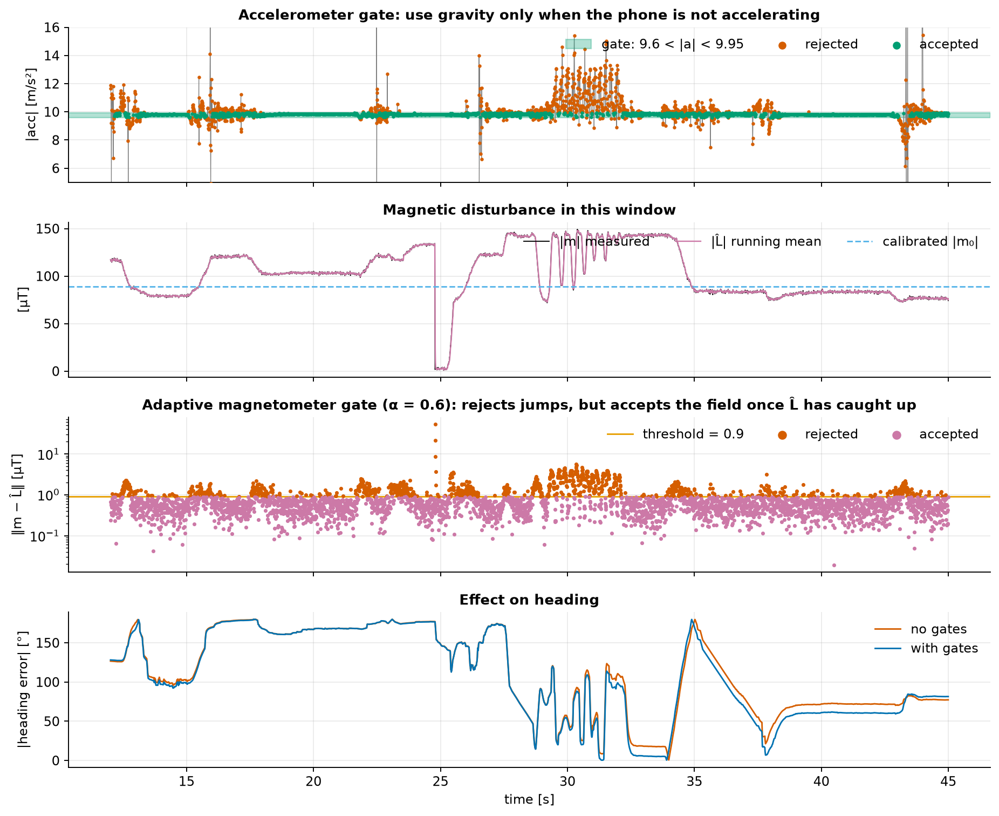
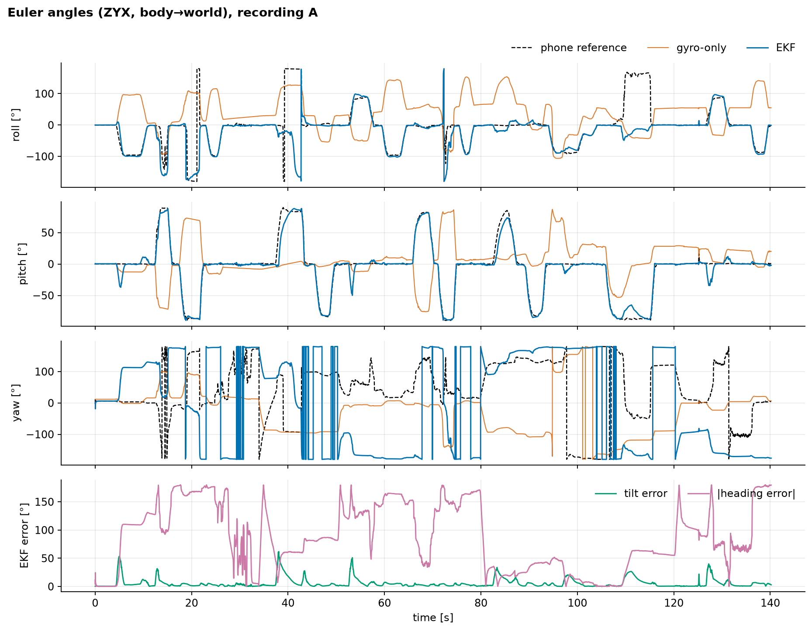
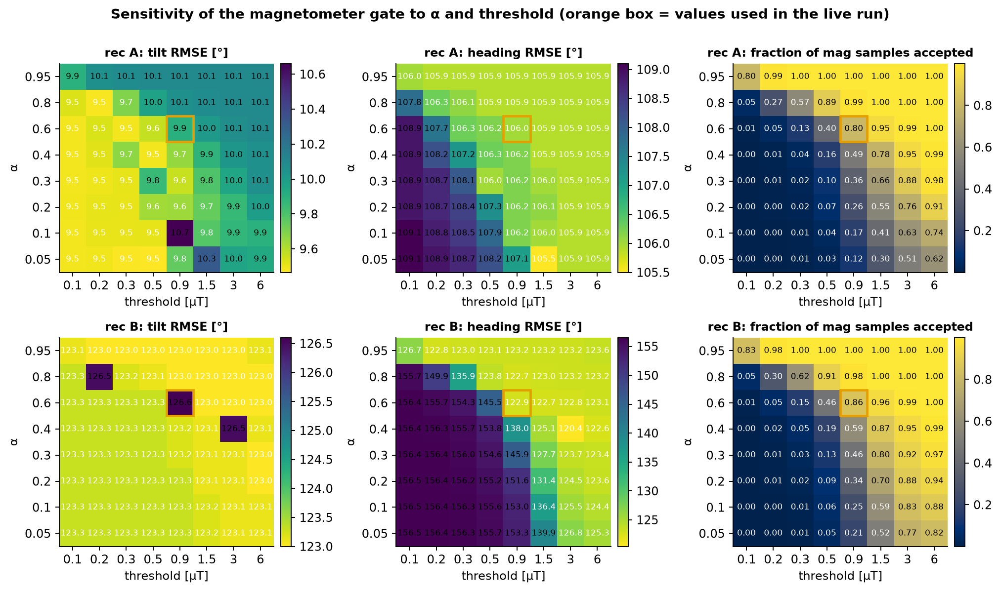

# Phone Orientation EKF

> **What is this project about?** A phone knows which way it is facing by combining three weak sensors. We built the filter that does this (a quaternion Extended Kalman Filter), and tested it on recorded live data, including hand motion and magnetic disturbance.

  

## TLDR


<sub>Recording A, 86–107 s (best-case window, picked automatically as the 20 s with the lowest heading error that still contains motion). Left: the phone's own estimate (reference). Middle: **our EKF**. Right: gyro integration only, never corrected. Over the whole recording the heading is mostly wrong (see below); this window is the best case. Bottom: error curves.</sub>

* **Problem:** estimate a phone's 3D orientation in real time from a gyroscope (drifts), an accelerometer (corrupted by hand motion) and a magnetometer (corrupted indoors).
* **Approach:** EKF with a unit quaternion as state. Gyro drives the prediction; accelerometer (gravity) and magnetometer (north) drive the corrections; two gates reject bad samples.
* **Results** (recording A, vs. the phone's own estimate):

Every number is an **angle error against the phone's own orientation estimate** (lower is better).

| Error vs. the phone's estimate | Our EKF | Gyro only |
|---|---|---|
| Tilt (roll/pitch), RMSE over the recording | **9.6°** | 92.2° |
| Tilt, worst single sample | **61.7°** | 175.9° |
| Heading (yaw), median error | 84.3° (below 20° for 13% of the time) | 75.8° |
| Heading (yaw), RMSE | 106.3° | 91.5° |

Tilt is tracked (median 3.0°, with short excursions during fast motion); heading is **not**: it is wrong for most of the recording, with or without the magnetometer.

## Repo Map

```
data/                       6 recordings (.mat), calibration.json, data description
src/python/orientation_ekf/ quaternion.py, ekf.py (filter core), data.py, metrics.py
src/python/run_demo.py      5-second demo
src/matlab/ekf/             ekfTimeUpdate, ekfMeasUpdate, ekfStep, ekfConfig, runEkfOffline
src/matlab/quaternion/      Qq, dQqdq, Somega, Sq, normalizeQuat, quatError, quatToEuler
src/matlab/live/            runEkfLive (smartphone stream + 3D viewer)
scripts/                    run_experiments.py, make_figures.py, make_animation.py, make_all.py
tests/test_filter.py        validation against the stored MATLAB output
results/                    metrics.csv, sensitivity.csv, figures/, animations/
docs/                       derivation.md, conventions.md, findings.md
```

## Problems we had to solve

| # | Problem | Why it matters |
|---|---|---|
| P1 | **Gyro drift** | Integrating angular rate accumulates error without bound. |
| P2 | **Accelerometer ≠ gravity** | It also feels hand acceleration, so the "down" direction is wrong while moving. |
| P3 | **Magnetic disturbance** | Indoors the field strength jumps between ~70 and ~145 µT, so heading is unreliable. |
| P4 | **Non-linear rotations** | Measurements are non-linear in the quaternion; it must stay unit length. |
| P5 | **Unknown sensor noise** | The filter needs covariances for all three sensors. |
| P6 | **Is the filter itself right?** | No ground truth exists; we only have the phone's own estimate to compare with. |


*What this shows: the raw input the filter gets (recording A), one row per signal. Rows 1–2: accelerometer and its magnitude; at rest the magnitude sits at gravity (≈9.8 m/s², inside the green accepted band) and spikes whenever the hand moves, so those samples are not a clean gravity reading (P2). Row 3: gyroscope. Rows 4–5: magnetometer and its magnitude; it should stay at the calibrated Earth-field value (line) but jumps in steps near magnets and metal (P3).*

## Approach we took


State: unit quaternion $q$ (world→sensor) and covariance $P$. Per sample: accelerometer update → gyro time update → magnetometer update. Full derivation in [docs/derivation.md](docs/derivation.md), conventions in [docs/conventions.md](docs/conventions.md).

**Time update** (gyro $\omega$, sample time $T$):
$$q\leftarrow\big(I+\tfrac T2 S(\omega)\big)q,\qquad P\leftarrow FPF^\top+G R_\omega G^\top$$

**Measurement update** for $y=Q(q)v_0+e$ with $v_0=g_0$ (accelerometer) or $m_0$ (magnetometer), linearised with $H=\big[\tfrac{\partial Q}{\partial q_i}v_0\big]_{i=0..3}$:
$$K=PH^\top(HPH^\top+R)^{-1},\quad q\leftarrow q+K\,(y-Q(q)v_0),\quad P\leftarrow P-KSK^\top$$

**Normalisation:** $q\leftarrow q/\|q\|$ with $q_0\ge0$ after every update.

**Outlier gates:**
* accelerometer update only if $9.6<\|a\|<9.95\ \text{m/s}^2$;
* magnetometer update only if $\|m_k-\hat L_k\|<\tau$, with running mean $\hat L_k=(1-\alpha)\hat L_{k-1}+\alpha m_k$ ($\alpha=0.6$, $\tau=0.9$ µT).

**Noise model:** $R_a$, $R_\omega$, $R_m$, $g_0$, $m_0$ are the mean and covariance of a stationary calibration recording ([`data/calibration.json`](data/calibration.json); e.g. $\mathrm{diag}\,R_a=[5.2,3.9,86]\cdot10^{-5}$, $\mathrm{diag}\,R_m=[0.59,0.41,1.04]$, $m_0=[0,\,55.8,\,-69.6]$ µT).

**Verification:** we ported the filter to Python and made it reproduce the quaternion output of our original MATLAB live runs on all 6 recordings (max difference 6.5e-8). The live run settings were recovered by searching for the settings that reproduce the stored output.

## Our solutions

### P1 Gyro drift, solved by fusion
Gyro-only tilt error is already 22° after 30 s on recording A and is as bad as a random orientation by 60 s (148°). With accelerometer fusion the tilt RMSE is 7.2° (max 32°, ungated).


Gyro-only tilt error after 30 / 60 / 120 s: **A 22° / 148° / 58°**, B 4.6° / 2.6° / 4.6° (B is mostly at rest).

### P2 Hand acceleration, solved by the accelerometer gate
Updates are skipped when $\|a\|$ leaves the gravity band (red samples below). In our offline runs the gate did **not** help: with it, tilt RMSE on A goes from 7.2° to 8.9° (max 32° to 61°), and on B from 8.1° to 123°, because skipped updates leave the filter to the gyro model, which drifts. The gates were tuned for the live recordings (A, C, E).



### P3 Magnetic disturbance, partly solved by the adaptive magnetometer gate
The gate rejects sudden field jumps (e.g. at 25 s where $|m|$ drops to ~0), but $\hat L$ catches up within a few samples, so it accepts a disturbance that persists. Heading is not tracked in this filter: the median heading error is 84° on A (13% of samples within 20°), and the magnetometer gate does not change it (83° ungated, 84° gated). Only in short stretches (e.g. 82–110 s) does the EKF yaw follow the phone's.



<!--
The sensitivity of the gate to $\alpha$ and $\tau$: tilt is insensitive (2.0–2.1° on A); heading is flat for large $\tau$ and collapses on B when a small $\tau$ rejects almost every magnetometer sample.


-->

### P4 Non-linearity, solved with the EKF Jacobian and renormalisation
$H=[\partial Q/\partial q_i\,v_0]$ is implemented in `dQqdq` and checked against finite differences in `tests/test_filter.py`. The covariance mapped to rotation angles grows during gyro prediction and shrinks at accepted updates:


### P5 Sensor noise, solved with calibration statistics
Mean and covariance from a stationary recording give $R_a,R_\omega,R_m$.


### P6 Is the filter right? Ablation and validation
**Ablation** (filters start from the reference so initial misalignment does not mask effects). The accelerometer bounds tilt (92° → 7–9° RMSE), but the magnetometer does not give a usable heading (median error 84° with accelerometer only, 84° with magnetometer added).


Further notes (reference convention, a complex-valued `m0` in the offline script, calibration consistency, over-confident covariance): [docs/findings.md](docs/findings.md).

### Real-time implementation
The filter ran live: the Sensor Fusion app streams over TCP (port 3400) into MATLAB, `runEkfLive` runs one filter iteration per received sample (data within 5 ms count as concurrent, ~125 Hz) and shows our phone box next to the phone's own, flagging samples rejected by the gates. The recordings in `data/` came from this setup.

## How to run

Python 3.10+, no MATLAB needed.

```bash
python -m venv .venv && source .venv/bin/activate
pip install -r requirements.txt
make demo         # ~5 s: EKF on recording A, prints metrics (tilt RMSE 9.90, heading median 84.08; starts from identity, not from the reference)
make test         # ~10 s: matches stored MATLAB output, Jacobian check
make figures      # ~5 min on 8 cores: regenerates every number, figure and the GIF
```
MATLAB/Octave: run `src/matlab/scripts/reproduceMetrics.m` (same numbers).

**Limitations (brief):**
* The phone's own estimate is the reference, not ground truth; heading differences can come from either estimator.
* Recording B is mostly stationary after 95 s with a constant but odd magnetometer norm (~40 µT); its heading numbers mainly show slow convergence.
* Offline MATLAB code was checked in GNU Octave 11.3, not MATLAB itself. `runEkfLive.m` was not re-run here: it needs the phone, the course's `sensordata.jar` (place in `src/matlab/live/lib/`, then `startup`) and `OrientationView.m`, which are not included.
* The raw stationary calibration recording is not included, only its mean and covariance.
* Our filter has no gyro-bias state and its covariance is over-confident (0.01–0.03° vs several degrees of real tilt error). Heading is the main open problem: it is wrong for most of the recording.

## Team Members

Group project of two students, built for SSY345 Sensor Fusion and Nonlinear Filtering, Chalmers.

## License

MIT, see [LICENSE](LICENSE).
